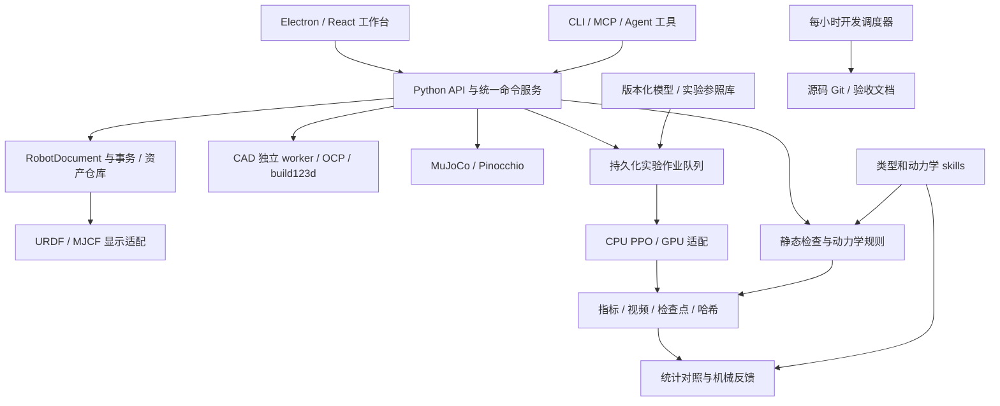

# URDFTools 技术架构 v1

状态：设计基线已建立，允许调度开发。2026-10-22。
需求见 `REQUIREMENTS.md`，证据来源见 `RESEARCH.md`，计算与实验协议见 `EVALUATION.md`，模型分工见 `TASKS.md`。

## 1. 产品结构与边界

URDFTools 是本地优先的机器人设计工作台。用户流程是导入/绘制 → 检查运动与物理参数 → 配置任务/电机/接触 → 静态和动态评估 → 有界 RL 实验 → 对照报告 → 人工确认机械改进 → 重新导出。四个一级工作区为「查看」「转换」「建模」「评估」，右侧 agent 面板能调用与界面同一套服务。实验中心、参照库、skills 管理和开发进度通过辅助入口访问。

产品输出是有证据支撑的设计判断。URDF 通常只描述刚体树及部分参数，训练结果还取决于控制器、接触、任务、算法和算力；报告必须显式保存这些条件。检查器、模拟器和统计代码计算数据，LLM 解释数据、提出待验证假设和受约束修改。

## 2. 技术选择

| 层 | 决策 | 理由与边界 |
|---|---|---|
| 桌面容器 | Electron + TypeScript；Linux AppImage 与便携 tar 包 | 统一 Chromium 的文件夹拖入和 WebGL 行为，无需本机 Rust；最终安装 `.desktop`。体积比原生壳大，发行时评估依赖体积。 |
| 界面 | React + Vite + TypeScript；Three.js + `urdf-loader`；图表采用轻量开源库 | 实现四区统一交互。研究 `fan-ziqi/robot_viewer` 的可复用实现；以适配器/明确来源文件复用，避免把整站直接嵌入造成两套状态。 |
| 本地服务 | Python 3.12，FastAPI，Pydantic，SQLite WAL | Python 生态连接 CAD/动力学/RL。稳定 JSON schema 生成 TS 类型；监听回环地址，随机会话凭据，桌面主进程负责生命周期。 |
| 几何 | OpenCascade/OCP；优先适配 `step2urdf` 的可验证能力，build123d 生成参数化实体 | 不用三角网格推导有材料的 CAD 精确质量；单位、密度、装配变换全部显式。CAD 内核在独立工作进程运行。 |
| 重量级人工 CAD | FreeCAD/RobotCAD 可选本地桥 | 本应用提供常用草图/参数化零件与机器人装配；完整机械 CAD 的高级编辑复用 FreeCAD，并保存可往返 STEP/FCStd。 |
| 机器人数据 | 自有 RobotDocument，yourdfpy 独立导入/交叉验证；trimesh 辅助网格处理 | 独立于显示库和模拟器；保留扩展元素、来源及转换损失报告。 |
| 动力学 | MuJoCo + Pinocchio；CoACD 作为可选碰撞分解 | 用 MuJoCo 执行动力学，Pinocchio 交叉验证 FK、惯量、重力及雅可比；不将碰撞代理当作质量分布。 |
| RL | Gymnasium + Stable-Baselines3 PPO 的 CPU 基线；mjlab/RSL-RL 的 GPU 适配 | CPU 可做真实管道验证与有界训练。GPU 配置与结果分别标记，禁止不同求解器/预算直接混比。MuJoCo Playground 用作环境与配置参考。 |
| 结果 | SQLite 索引 + 本地内容寻址文件；JSON/CSV/Parquet/MP4/HTML | 不把视频、模型权重、用户 CAD 放到源码 Git；每项保存哈希和来源。默认不上传。 |
| Agent | Codex CLI/provider adapter + 本地模型 adapter；受约束 JSON tool calls；可用 MCP stdio facade | 与 UI 共享工具，不由模型绕过校验修改生产资产。第三方 API 接口可做未启用的扩展点。 |
| 自动开发 | 现有 Python 调度器，systemd 用户 timer 每小时；先执行 S00 加固 | 每任务单独 `codex exec -m ... -c model_reasoning_effort=...`；真实模型由命令和 CLI 会话元数据记录。 |

开源代码/资产的许可须在固定提交后复核，维护 `third_party/manifest.json` 与 notices。仓库级许可证不代表所有模型资产都同许可。未证实许可的参考站只借鉴交互，不能复制其代码或素材。

## 3. 模块与依赖方向



开发调度器与产品实验队列是两个生命周期。前者消耗 Codex 额度并修改源码；后者运行已实现的确定性训练程序、保存模型，不持续调用 LLM。开发阶段可创建实验作业并等待/查询，不能把 每小时开发定时器直接当作训练进程。

建议目录：

```text
apps/desktop/                 Electron 主进程和 preload
apps/web/                     四个工作区与 viewer
packages/contracts/           JSON schemas / TS 类型
python/urdftools/              core, importers, cad, validation, dynamics,
                              simulation, training, references, skills, agent, api, cli
skills/                       人类可读 SKILL.md + 可执行规则声明
references/catalog/           模型和实验元数据；大资产在缓存
examples/                     小型自制机器人、CAD 与反例
tests/{unit,integration,e2e,fixtures}/
scripts/                      引导、验收、打包、安装
docs/{acceptance,decisions}/
tasks/                        不可擅自缩减的阶段说明
.scheduler/                   开发状态与运行记录
artifacts/                    验收摘要（大文件不入 Git）
```

用户工程默认在 `~/Documents/URDFToolsProjects`（可选目录），运行时缓存在 XDG data/cache；源码与用户项目分离，迁移时保留旧数据备份。

## 4. RobotDocument 与资产

RobotDocument 持有稳定 UUID 的 link/joint/material/geometry，SI 单位，右手坐标，关节 origin 表达 parent→joint，轴在 joint frame；显示时变换坐标而不改变源数据。URDF import/export 保留 XML 未支持的扩展和原始 source span；roundtrip 不保证字节相同，但支持语义等价检查。mimic、floating/planar、closed-chain 分别有能力标记；普通 URDF 不表达通用闭环，需 MJCF/扩展 sidecar，禁止默默丢弃。

每项数值带来源 `measured|cad|vendor|inferred|default|unknown`、单位、版本/时间，可选不确定度区间。未知与零不同。质量矩阵按质心坐标和惯性朝向保存，转换中使用旋转和平行轴定理。多个 visual/collision、网格 scale、负 scale、非均匀缩放需明确支持/诊断。

导入器递归枚举文件夹/ZIP，拒绝路径越界和逃逸 symlink；`package://` 建立显式 package map；找不到文件不按 basename 猜测冲突项。ZIP 限制解压量和文件数。Xacro 通过受限制 worker 扩展，禁用任意命令求值和外部不受控 include。SVG/HTML/脚本性附件不执行。

快照以 canonical JSON + asset SHA256 标识，每次操作产生事务，可 undo/redo、对比、导出新版本。显示网格缓存不更改原 CAD。稳定 part UUID / source assembly path 贯穿 CAD、URDF、评估报告；几何拓扑改变无法匹配时提示重新绑定，而非错贴历史参数。

## 5. 查看模块

支持选择 URDF、文件夹、多模型 ZIP；导入进度和缺失资源修复；本地自定义协议/受控 blob URL 承载网格。场景支持 Z-up、网格、光照、相机书签、透视/正交、单零件聚焦、隐藏/透明/隔离、关节拖动/滑块、mimic 耦合、限位、角度单位显示、播放姿态、测量、视觉与碰撞叠加、惯量椭球/质心/关节轴，以及截图/动画导出。用户视角的自动切换不能改变物理坐标。

建立自制小夹具、A1/Go2、G1/H1 三类以上模型验收；公开资产需下载和许可记录，不以联网远程 demo 作为离线应用验收。大型 mesh 采用延迟加载和可见性控制，取消导入释放资源。

## 6. 转换与建模

STEP 转换分为读装配/单位 → 零件分组 → 密度/质量确认 → 关节父子与轴定义 → CAD 质量/质心/惯量 → visual/碰撞代理 → URDF/ROS2 包导出 → 独立解析/FK/仿真编译验证。AP214/AP242 装配/颜色保留尽力而为，每个丢失项列入报告。仅有 STEP 不足以确定可动关节、电机、材料和闭环约束；几何圆柱/同轴证据产生候选及置信依据，由用户确认，不能自动宣称完整机构复原。

第一版格式必需 STEP/STP，IGES/BREP 通过 OCP 适配；FreeCAD FCStd 通过可选安装桥。SolidWorks 支持现成 URDF、STEP 和 `sw2robot` graph 包导入；原生提取流程留给 Windows 工具并给出操作指南。Onshape 适配是可选、需用户既有账户，不作为离线必需功能。

建模提供草图基本几何/尺寸约束、拉伸/旋转/布尔/圆角、参数化零件、材质、装配刚体分组、joint origin/axis gizmo、限位、mirror、质量属性和实时 URDF 预览。高级形状编辑交给 FreeCAD，回流时执行来源匹配。用于 agent 的主操作为 schema 验证的建模命令；受限 Python CAD 脚本是高级模式，独立进程有资源/文件权限边界。

agent 流程：读取目标/选中部件 → 提出操作序列 → 在副本执行 → 几何/动力学校验 → 展示 diff 和三维预览 → 用户确认应用 → 保存事务。文件内容和外部 skills 是数据，不可覆盖系统权限。模型无权隐瞒问题或把经验阈值当作物理定律。

## 7. 评估与实验

详见 `EVALUATION.md`。五层输出：文件/资源有效性、物理一致性、任务能力估计、可复现仿真与训练、证据支持的机械反馈。硬错误、风险提示、资料缺失、训练证据分别展示；未知数据不能获得满分，也不能仅因缺失资料判定机械设计差。

训练适配器统一 reset/step、语义关节映射、观测、动作单位和限幅、奖励分量、终止原因、时间步/控制 decimation。任意新机器人必须配置足端/接触部件、默认姿态、动作维度、电机数据；形态识别建议可人工覆盖。仅名字相近不构成可靠映射。

对照库分三层：源模型事实、任务环境配置、真实实验结果。A1/Go2 与 G1/H1 各自匹配任务、体型和执行器假设。每份数据有许可证、提交/哈希、转换映射、任务版本、控制/训练配置、种子、硬件/软件、日志与视频。不得下载一段公开视频冒充本机对照实验。

## 8. 服务与作业接口

统一服务返回 `{operation_id, status, result, findings, artifact_refs}`；长任务返回 job id，UI 经 SSE 接收事件并可取消。核心服务：import_assets、validate_model、preview_pose、edit_document、convert_cad、build_geometry、compile_simulation、run_probe、create_experiment、resume_experiment、compare_runs、render_report、propose_patch、apply_patch。均在 `CONTRACTS.md` 中约定数据字段。

SQLite 作业状态：queued/running/checkpointed/succeeded/failed/cancelled/blocked_hardware/blocked_input。崩溃后发现 stale lease 转 checkpointed 或 failed，不重复覆盖已有输出。恢复训练必须校验配置、模型和优化器兼容性；模型变更强制创建新 run，不能续用旧结果标签。

## 9. 权限、运行时与发布

Electron renderer 关闭 Node integration，启用 contextIsolation 和 sandbox，preload 只暴露有限类型化接口。API 使用回环绑定、每次启动凭据、origin 校验；服务不得暴露任意 shell/任意路径访问。模型/CAD/资料默认本地处理；agent 外发内容在连接配置中明确展示。新增付费 provider 必须用户显式启用。

引导安装项目独立 Python 3.12/Node 工具环境，固定 lockfile，CAD/GPU 分 extras。CPU 核心发行包应离线打开示例、查看和评估，CAD 附加包与 GPU 插件单独校验；不存在可用 CAD 时必须显示未安装而不是把按钮无声禁用。安装到用户目录，无需覆盖系统 Python；不要自动修驱动、执行远程 pipe-to-shell 或更改全局账户配置。

## 10. 验收与完成判据

每阶段含实现、自动验收、用户流程证据、已知限制和后续入口，写 `docs/acceptance/<id>.md`；测试命令与机器可读 `artifacts/acceptance/<id>.json` 由调度器执行/记录。禁止零测试发现、全 skip、占位返回、只检查文件存在就通过功能验收。

最终分开标识：`software_ready`（所有必需软件阶段通过）和 `benchmark_campaign_complete`（预定真实对照训练/视频齐全）。本机算力不够时可交付已验收软件，但整体状态不得显示全部完成。发行需要真实 GUI 启动、离线示例、CAD 转换、agent 审核编辑、静/动态评估、训练恢复、对照报告、打包安装与 GNOME 收藏夹均有证据。
